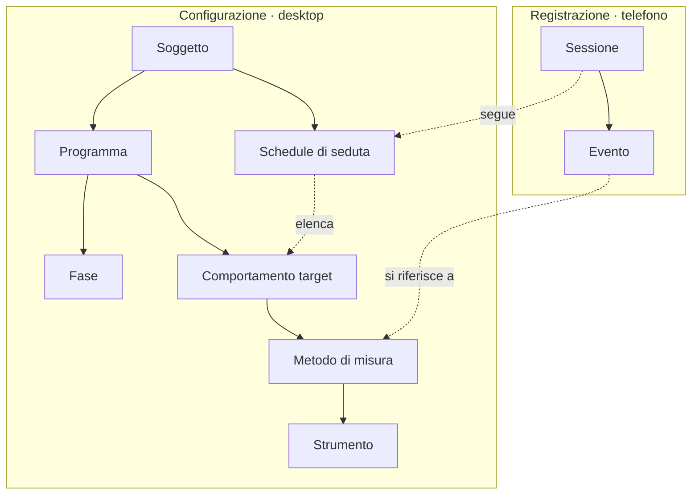

# Modello dei dati e misure ABA

Passo 1 del piano, 13 ottobre 2026. Versione modificabile e commentabile: [Claude Doc](https://claude.ai/code/artifact/78cfd7eb-7760-4c73-a9ef-a5e7b2629557). Questa copia nel repository è il riferimento per il codice dei prototipi.

## Scopo e principi

Questo documento fissa le entità, le misure ABA e le regole di registrazione su cui costruiamo i prototipi desktop (passo 2) e mobile (passo 3). Si parte dalla versione clinica con dati finti; la sperimentale riusa la stessa struttura.

Quattro principi guidano le scelte:

- **Configurazione separata dalla registrazione.** Sul desktop si definisce cosa misurare e come; sul mobile si registra soltanto, con i pulsanti già pronti.
- **Si salva l'evento grezzo, non il risultato.** Ogni tocco sul telefono diventa un evento con orario; frequenze, durate e percentuali si calcolano dopo. Così un errore di calcolo non fa perdere dati.
- **Offline prima di tutto.** Il telefono deve poter aprire la seduta, registrare e mostrare il riepilogo senza rete, e sincronizzare quando torna la connessione.
- **Uno schema, due contesti.** Clinica e sperimentale condividono le entità; cambiano nomi, campi obbligatori e alcune funzioni (sezione dedicata).

## Entità del modello dati

Il modello ha due metà: la configurazione (dal soggetto fino allo strumento) si prepara sul desktop; la registrazione (sessione ed eventi) nasce sul telefono e punta alla configurazione.

Le frecce piene indicano "contiene"; quelle tratteggiate indicano un riferimento. L'evento è l'unico dato registrato: tutto il resto si calcola da lui.

| Entità | Cosa rappresenta | Campi principali | Dove si crea |
| --- | --- | --- | --- |
| Soggetto | Il paziente (clinica) o il partecipante (sperimentale) | Codice pseudonimo, anno di nascita, note, operatori assegnati | Desktop |
| Programma | Un obiettivo di intervento su cui si lavora | Nome, area (comportamento da ridurre o abilità da insegnare), stato attivo/sospeso/concluso | Desktop |
| Fase | Un periodo del programma con la stessa condizione | Tipo (baseline, intervento, mantenimento, generalizzazione), data di inizio e fine, nota sul cambio | Desktop |
| Comportamento target | Ciò che si osserva | Nome, definizione operativa (cosa conta, cosa no, esempi), direzione desiderata (aumentare o ridurre) | Desktop |
| Metodo di misura | Come si misura quel target | Tipo di misura, parametri (lunghezza intervallo, numero di prove, gerarchia dei prompt), criterio di padronanza | Desktop |
| Strumento | Il controllo che compare sul telefono | Tipo (contatore, cronometro, timer a intervalli, griglia prove, scheda ABC), etichette e colori dei pulsanti | Desktop, derivato dal metodo |
| Schedule di seduta | Il modello di una seduta | Elenco ordinato dei target con il loro strumento, durata prevista, setting | Desktop |
| Sessione | Una seduta svolta | Data e ora, operatore, setting, fase in corso, durata reale, stato (aperta, chiusa, sincronizzata) | Telefono |
| Evento | Un singolo dato registrato | Target, metodo, tipo di evento, istante, valore (es. livello di prompt), autore | Telefono |
| Operatore | Chi usa la piattaforma | Nome, ruolo (supervisore, terapista, osservatore) | Desktop |

Regole di relazione: un soggetto ha più programmi; un programma ha più fasi e più target; ogni target ha di norma un metodo, ma può averne più di uno (es. frequenza e durata dello stesso comportamento). Una sessione segue una schedule e raccoglie gli eventi; ogni evento indica target e metodo, così i grafici sanno sempre a cosa appartiene.

Il piano di intervento (ruoli dei target, funzione, fasi pianificate, conseguenze programmate) è descritto in [piano-intervento.md](piano-intervento.md).

## Misure ABA standard

Dieci tipi di misura coprono quasi tutti i programmi ABA; ognuno ha uno strumento sul telefono e una regola di calcolo. Per tutti, il telefono salva solo eventi con orario.

| Misura | Quando usarla | Strumento sul telefono | Eventi salvati | Valore per sessione |
| --- | --- | --- | --- | --- |
| Frequenza e tasso | Comportamenti brevi e contabili (colpi, richieste) | Contatore con + e − | Un evento "occorrenza" per tocco; "annulla" per il − | Numero di occorrenze; tasso = occorrenze / minuti osservati |
| Durata | Comportamenti che durano (pianto, attenzione al compito) | Cronometro avvia/ferma | "inizio" e "fine" di ogni episodio | Durata totale, media per episodio, % del tempo di sessione |
| Latenza | Tempo tra istruzione e risposta | Cronometro a due tocchi | "istruzione" e "risposta" | Latenza media e mediana in secondi |
| Tempo tra risposte (IRT) | Ritmo di un comportamento | Contatore (deriva dagli orari) | Come la frequenza | IRT medio in secondi |
| Intervallo parziale | Comportamenti frequenti o difficili da contare | Timer a intervalli con sì/no | Per ogni intervallo: sì o no | % di intervalli con il comportamento (tende a sovrastimare) |
| Intervallo totale | Comportamenti da aumentare e continui | Timer a intervalli con sì/no | Per ogni intervallo: sì o no | % di intervalli con comportamento per tutto l'intervallo (tende a sottostimare) |
| Campionamento momentaneo | Osservazioni lunghe o più soggetti | Timer che vibra a fine intervallo | Per ogni istante: sì o no | % di istanti con il comportamento |
| Prove discrete (DTT) con prompt | Insegnamento di abilità | Griglia prove con pulsanti corretto, errore, livelli di prompt | Per ogni prova: esito e livello di prompt | % di risposte corrette indipendenti; distribuzione dei prompt |
| Task analysis | Catene di passi (lavarsi le mani) | Lista dei passi con livello di prompt | Per ogni passo: livello di prompt | % di passi indipendenti |
| ABC | Osservazione descrittiva per l'ipotesi di funzione (non è un intervento) | Scheda rapida con scelte predefinite | Antecedente, comportamento, conseguenza, nota | Conteggio per combinazione A-B-C |

Gerarchia dei prompt di default (dal più al meno intrusivo): fisico totale, fisico parziale, modello, gestuale, verbale, indipendente. È modificabile per programma.

Il criterio di padronanza di default è "90% di risposte indipendenti per 3 sessioni consecutive" (era 80%: alzato il 13 ottobre 2026 dopo la [ricerca di letteratura](ricerca-letteratura.md), vedi Richling, Williams & Carr, 2019), modificabile per metodo. Quando viene raggiunto, il desktop lo segnala e propone il cambio di fase.

## Sessioni e rilevazioni offline

Il telefono lavora sempre sulla sua copia locale e manda al server solo eventi nuovi: così la seduta non si blocca mai per la rete e nessun dato viene sovrascritto.

1. **Prima della seduta**, il telefono scarica (quando c'è rete) soggetti assegnati, schedule, target, metodi e strumenti, più gli ultimi riepiloghi.
2. **Durante la seduta**, ogni tocco crea un evento salvato subito sul telefono, con un identificativo univoco generato in locale, l'orario del dispositivo e l'operatore.
3. **A fine seduta**, l'operatore chiude la sessione; il telefono calcola il riepilogo in locale, così è visibile anche senza rete.
4. **Alla sincronizzazione**, il telefono invia gli eventi non ancora confermati; il server li accetta una sola volta grazie all'identificativo e ricalcola i valori per i grafici.

Regole sui conflitti:

- Gli eventi non si modificano né si cancellano: una correzione è un nuovo evento "annulla" che punta a quello sbagliato. Due telefoni quindi non entrano mai in conflitto sui dati registrati.
- Se la configurazione cambia sul desktop mentre un telefono è offline, la sessione resta legata alla versione con cui è stata registrata; ogni metodo ha un numero di versione.
- Due operatori sullo stesso soggetto nella stessa ora producono due sessioni distinte; se una è marcata come osservazione di controllo, serve per l'accordo tra osservatori (IOA).

Nei prototipi dei passi 2 e 3 la sincronizzazione è simulata: i dati restano nel browser e un interruttore "online/offline" mostra cosa succede. Nella versione vera (passo 4) la sincronizzazione con il cloud segue queste stesse regole: vedi [decisione-tecnologica.md](decisione-tecnologica.md#come-funziona-la-sincronizzazione).

## Output: grafici e riepilogo

Ogni grafico nasce dal valore per sessione del metodo di misura, quindi il tipo di misura decide il grafico senza che l'utente debba configurarlo.

**Desktop, grafici secondo le convenzioni ABA:**

- Asse orizzontale = sessioni (o date), asse verticale = il valore del metodo con la sua unità (occorrenze/minuto, secondi, %).
- Una linea per fase, interrotta al cambio di fase, con una linea verticale tratteggiata e il nome della fase in alto.
- Linea orizzontale del criterio di padronanza, quando esiste.
- Per le prove discrete, a richiesta, barre impilate della distribuzione dei livelli di prompt.
- Scala lineare di default; scala logaritmica (tipo grafico standard di celerazione) come opzione futura.

**Mobile, riepilogo configurabile:** per ogni target scelto, l'ultimo valore, la media delle ultime N sessioni (default 5), una mini-linea delle ultime sessioni e un segnale se il criterio è vicino o raggiunto. L'operatore sceglie quali target vedere e in che ordine.

## Differenze tra clinica e sperimentale

Le entità restano le stesse; cambiano i nomi mostrati, alcuni campi e quanto il sistema è rigido sul protocollo.

| Aspetto | Clinica | Sperimentale |
| --- | --- | --- |
| Soggetto | Paziente, con anamnesi breve e operatori di riferimento | Partecipante, con codice di studio e gruppo o condizione |
| Programma | Obiettivo terapeutico, modificabile in corso | Condizione sperimentale definita dal protocollo |
| Fasi | Baseline, intervento, mantenimento, generalizzazione | Fasi del disegno (A-B-A-B, linea di base multipla, trattamenti alternati), con ordine previsto |
| Modifiche alla configurazione | Libere, con versione salvata | Bloccate dopo l'avvio; ogni deviazione va motivata e registrata |
| Accordo tra osservatori (IOA) | Facoltativo | Previsto su una quota di sessioni (es. 20-33%), con calcolo automatico |
| Fedeltà del trattamento | Facoltativa | Lista di controllo per sessione |
| Output | Grafici per il team e riepilogo per la famiglia | Grafici per pubblicazione ed esportazione dati grezzi (CSV) |

Nei prototipi si costruisce solo la colonna clinica; i campi della sperimentale restano previsti nello schema ma nascosti.

## Default scelti e dati per i prototipi

Dove mancava un'indicazione di Andrea è stato scelto un default; ognuno si può cambiare senza rifare il modello.

- Gerarchia dei prompt a sei livelli e criterio di padronanza al 90% per 3 sessioni (sezione Misure).
- Intervalli di default di 10 secondi per il campionamento a intervalli, sessioni di 30 minuti.
- Riepilogo mobile sulle ultime 5 sessioni.
- Il soggetto è identificato solo da un codice pseudonimo, già pensando al GDPR.

Dati finti per i prototipi: 3 pazienti, ciascuno con 2-3 programmi che coprano frequenza, durata, intervallo parziale e prove discrete, 15-20 sessioni divise tra baseline e intervento, con un programma che raggiunge la padronanza.
